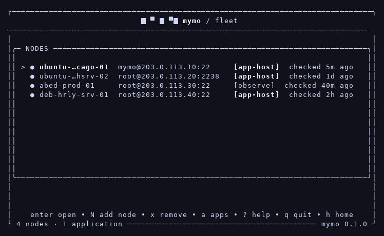
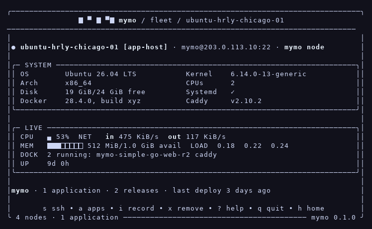

# mymo

Local-first, terminal-native VPS management. One binary on your
workstation — no mymo server, no cloud, no accounts. mymo remembers
your servers, watches them over SSH, and on the ones you choose,
runs containerized HTTP applications behind Caddy — health-gated
releases, clean rollbacks, everything visible in one TUI.

## Install

Linux:

    curl -fsSL https://raw.githubusercontent.com/elvonpiko/mymo/main/scripts/install.sh | bash

Windows (PowerShell):

    irm https://raw.githubusercontent.com/elvonpiko/mymo/main/scripts/install.ps1 | iex

Or from source — Go 1.26 or newer:

    git clone https://github.com/elvonpiko/mymo.git
    cd mymo && make build

## The tour

    mymo                         # the TUI — ? shows keys, q quits
    mymo node add                # name a server once, never type its IP again
    mymo node inspect <name>     # what mymo knows about it
    mymo node ssh <name>         # a plain SSH shell, as first-class as ever

Inside the TUI, `n` opens the fleet and `enter` inspects a node.
To prepare a node as an application host, open its page and press
`I` — mymo plans every change, applies it narrated, and verifies
after. To deploy, `d` from home or `mymo deploy` in the project
directory — a `mymo.yaml` says exactly what runs; mymo never guesses.

Your whole fleet lives in `~/.mymo` as plain JSON. Plain SSH remains
the escape hatch at every step.

## What mymo is not

Not a PaaS, not Kubernetes, not infrastructure-as-code, not a CI
provider, not a monitoring stack. mymo manages a small fleet well
and refuses to pretend to be more. Nodes run Ubuntu 22.04 / 24.04 /
26.04 LTS or Debian 12 / 13, on amd64 or arm64 — anything else is
refused by name rather than guessed about.

## Development

    make build    # build ./mymo
    make test     # run all tests
    make vet      # go vet
    make release  # build every platform into dist/

## License

[MIT](LICENSE)
