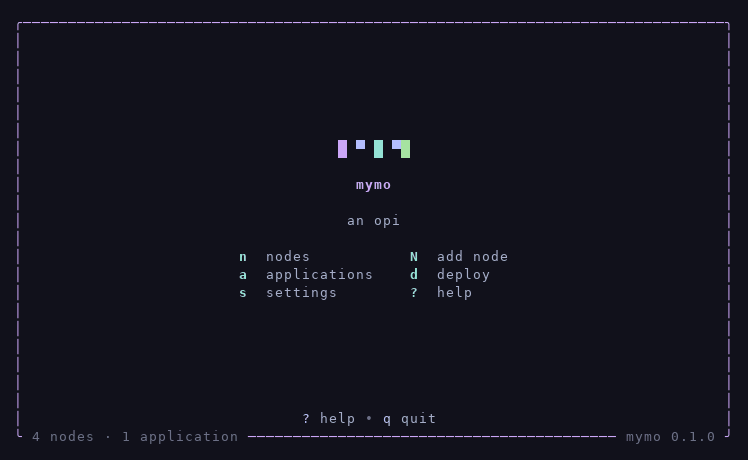

<h3 align="center">A simple VPS fleet for terminal enjoyers.</h3>

  Local-first, terminal-native VPS management — one binary, no server, no accounts. 
  mymo remembers your servers, watches them over SSH, and on the ones you choose, 
  runs containerized HTTP applications behind Caddy.

  
  
  
  

mymo in motion — home, the fleet, a node opened live, the gauges
carrying numbers, recorded from the real interface:

## What mymo does

- **Manage a fleet** — name a server once and never type its IP again; its health, facts, and last-check age at a glance.
- **Inspect any server** — a read-only observe mode: connect, report, modify nothing.
- **Deploy applications** — image, Dockerfile, or compose; mymo builds on the node, gates every release behind a health check, routes it through Caddy, and rolls back cleanly.
- **Plain SSH always** — every escape hatch stays first-class; your servers never need mymo at runtime.

## Install

Linux:

    curl -fsSL https://raw.githubusercontent.com/elvonpiko/mymo/main/scripts/install.sh | bash

Windows (PowerShell):

    irm https://raw.githubusercontent.com/elvonpiko/mymo/main/scripts/install.ps1 | iex

Or from source — Go 1.26 or newer:

    git clone https://github.com/elvonpiko/mymo.git
    cd mymo && make build

## The tour

    mymo                         # the TUI — ? shows keys, q quits
    mymo node add                # name a server once, never type its IP again
    mymo node inspect <name>     # what mymo knows about it
    mymo node ssh <name>         # a plain SSH shell, as first-class as ever

Inside the TUI, `n` opens the fleet and `enter` inspects a node.
To prepare a node as an application host, open its page and press
`I` — mymo plans every change, applies it narrated, and verifies
after. To deploy, `d` from home or `mymo deploy` in the project
directory — a `mymo.yaml` says exactly what runs; mymo never guesses.

## How deployment works

A `mymo.yaml` in the project directory is the whole contract:

    # mymo deploys exactly what this file says — nothing is guessed.
    name: simple-go-web
    type: image                # image | dockerfile | compose
    image: ghcr.io/example/simple-go-web:1.4.2
    port: 8080                 # the port inside mymo's network
    domain: web.example.com    # public HTTP through caddy
    health: /healthz           # the gate every release must pass

On the node, mymo pulls or builds, runs the container on mymo's
private network with a pinned address, health-checks it before
taking over the route, then retires the previous release. If
anything fails, the route never moves — and a rollback replays the
last good pair verbatim. No ports are published to the host; only
Caddy sees the container.

## Security and your data

- Everything lives in `~/.mymo` on your machine — plain JSON you
  can read, back up, or delete. There is no mymo cloud and nothing
  leaves your workstation but SSH.
- mymo never stores passwords; keys are referenced by path, never
  copied. Every connection honors known-hosts trust.
- Observe mode never modifies a server. Preparing an app host
  plans every change and applies nothing past an undecided audit;
  each apply is narrated step by step and verified after.
- Plain SSH remains the escape hatch at every step.

## What mymo is not

Not a PaaS, not Kubernetes, not infrastructure-as-code, not a CI
provider, not a monitoring stack. mymo manages a small fleet well
and refuses to pretend to be more. Nodes run Ubuntu 22.04 / 24.04 /
26.04 LTS or Debian 12 / 13, on amd64 or arm64 — anything else is
refused by name rather than guessed about.

## Development

    make build    # build ./mymo
    make test     # run all tests
    make vet      # go vet
    make release  # build every platform into dist/

## License

[MIT](LICENSE)
